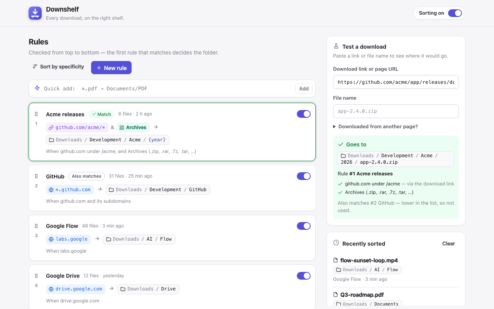

<p align="center">
  
</p>

<h1 align="center">Downshelf</h1>

<p align="center">
  <strong>Every download, on the right shelf.</strong><br />
  A Chrome extension that sorts downloads into folders with simple, ordered rules.
</p>

<p align="center">
  <a href="https://github.com/ghassenbrg/downshelf/actions/workflows/ci.yml"></a>
  <a href="https://github.com/ghassenbrg/downshelf/releases/latest"></a>
  <a href="LICENSE"></a>
</p>

<p align="center">
  <a href="https://ghassenbrg.github.io/downshelf/">Website</a> ·
  <a href="https://ghassenbrg.github.io/downshelf/guide.html">Guide</a> ·
  <a href="https://ghassenbrg.github.io/downshelf/privacy.html">Privacy</a>
</p>

<p align="center">
  
</p>

## What it does

Write rules like these and Downshelf files each download in the right subfolder of your
Downloads folder automatically:

```
github.com/org/*     →  Development/MyOrg
*.github.com         →  Development/GitHub
labs.google          →  AI/Flow
invoice-*, receipt-* →  Finance/{year}
*.pdf                →  Documents/PDF
images               →  Images
```

- **Match on anything useful.** Website (`*.google.com`), part of a site
  (`example.com/reports/*`), file name (`*.pdf`, `invoice-*`) or file type (Images, Archives,
  Installers…). Combine conditions with `&`, for example `*.github.com & *.zip → Releases`.
- **Predictable priority.** Rules are checked top to bottom and the first match wins, like email
  filters. Drag to reorder them. New rules are slotted above broader ones automatically, and
  Downshelf warns you when a rule can never fire because a rule above catches everything it would
  match ("Move above it" fixes it in one click).
- **See before you save.** Paste any link or file name into **Test a download** to see where it
  would go, which rule matched and why, and which other rules also matched.
- **Quick add.** Type `*.pdf → Documents/PDF` and press Enter.
- **Folder variables.** Use `{domain}`, `{host}`, `{category}`, `{ext}`, `{year}`, `{month}`,
  `{day}` or `{date}` in a destination, for example `Sites/{domain}/{year}`.
- **Pause, backup, restore.** One switch pauses sorting. Rules can be exported as JSON and imported
  again (plain-text rule lists work too).
- **Private.** No network access and no analytics. Everything is stored locally with
  `chrome.storage`.

## Install

**Chrome Web Store:** coming soon.

**From a release:** download `downshelf-chrome-vX.Y.Z.zip` from the
[latest release](https://github.com/ghassenbrg/downshelf/releases/latest) and unzip it. Then open
`chrome://extensions`, turn on **Developer mode**, click **Load unpacked**, and select the unzipped
folder.

**From source:** clone the repo and **Load unpacked** the **`extension`** folder. There is no build
step: the folder you load is the source.

Downshelf opens its settings page with a few starter rules. Pin the toolbar icon for quick access.

## Using it

| Want to…                         | Do this                                                                                                 |
| -------------------------------- | ------------------------------------------------------------------------------------------------------- |
| Add a rule fast                  | Type into **Quick add**, e.g. `drive.google.com → Drive`, and press Enter                              |
| Add a rule with a form           | **New rule**, or click the toolbar icon → **New rule for <site>** on the site you're on                |
| Change priority                  | Drag the ⋮⋮ handle, or focus it and press ↑ / ↓. **Sort by specificity** orders everything for you |
| Check a rule                     | Paste a link into **Test a download**; the matching rule is highlighted in the list                    |
| Keep some files out of a rule    | Add a more specific rule above it with destination `Downloads` (files stay at the top level)            |
| Turn sorting off temporarily     | The switch in the header or in the toolbar popup                                                        |

### Pattern cheat sheet

| Pattern                 | Kind      | Matches                                                       |
| ----------------------- | --------- | ------------------------------------------------------------- |
| `example.com`           | Website   | example.com and www.example.com                               |
| `*.google.com`          | Website   | google.com and every subdomain (drive., docs., …)             |
| `github.com/org/*`      | URL       | anything under `/org` on github.com                           |
| `example.com/reports`   | URL       | `/reports` and everything below it                            |
| `*.pdf`                 | File name | any PDF                                                       |
| `invoice-*, receipt-*`  | File name | names starting with either prefix (`,` means "or")            |
| `Invoice-????.pdf`      | File name | `?` matches exactly one character                             |
| `images`, `archives`    | File type | a family of extensions/MIME types                             |

The kind is detected as you type, and you can always change it. In quick add you can force a kind
with a prefix: `site:`, `url:`, `file:` or `type:` (for example `file:install.sh`).

Website and URL conditions check the download link, its final URL after redirects, **and** the page
you downloaded from. That's why `drive.google.com` matches Drive downloads that are actually served
from `drive.usercontent.google.com`.

## How Chrome limits download locations (and how to work around it)

Chrome only lets extensions choose a path **relative to your download folder**, through
[`chrome.downloads.onDeterminingFilename`](https://developer.chrome.com/docs/extensions/reference/api/downloads#event-onDeterminingFilename).
Absolute paths and `..` are ignored. Downshelf follows that rule. It never tries to write anywhere
else, and the editor rejects destinations like `/Users/me/Projects` with an explanation.

If you want files to land outside Downloads, you can set this up yourself:

1. **Move Chrome's download location up a level.** In `chrome://settings/downloads`, set
   **Location** to a parent folder (for example your home folder). Destinations then become
   relative to that folder: `Documents/PDF`, `Projects/Specs`, or `Downloads` for the old default.
2. **Link an outside folder into Downloads.** Chrome follows links, so create one and use its name
   as the destination:

   ```bash
   # macOS / Linux
   ln -s ~/Projects ~/Downloads/Projects
   ```

   ```bat
   :: Windows (Command Prompt) — a directory junction
   mklink /J "%USERPROFILE%\Downloads\Projects" "D:\Projects"
   ```

   Then a rule like `github.com/my-org/* → Projects/Releases` saves into `~/Projects/Releases`.

Other things worth knowing:

- **Other download extensions.** If several extensions suggest filenames, Chrome uses the most
  recently installed one. Disable other download managers if your rules seem ignored.
- **"Ask where to save each file"** in Chrome settings still works: the Save dialog opens
  pre-filled with Downshelf's folder.
- **Name conflicts.** In Settings, choose whether existing files are kept (a number is added),
  replaced, or whether Chrome asks you.

## Development

Requirements: Node.js 20.11+ (only for tooling; the extension itself has no dependencies).

```bash
npm ci                   # installs Biome (lint + format), the only dev dependency
npm test                 # rule engine + service worker tests (node:test)
npm run lint             # Biome lint + format check (npm run format to fix)
npm run preview          # UI preview at http://localhost:5179 with a mocked chrome.* API
npm run validate         # lint + tests + build + build validation (what CI runs)
npm run pack:chrome      # build → validate → dist/packages/downshelf-chrome-vX.Y.Z.zip
npm run icons            # re-render the PNG icons from code
npm run store:assets     # re-render Chrome Web Store screenshots and promo tiles
```

`npm run preview` serves the options page and popup in a normal browser tab, with
`dev/chrome-shim.js` standing in for `chrome.storage` (backed by `localStorage`). It's the fastest
way to work on the UI. Use **Load unpacked** to test real downloads, then click the reload icon on
`chrome://extensions` after changes to `background.js`.

### Releasing

Releases are tag-driven and publish to GitHub Releases and the Chrome Web Store:

```bash
npm version minor        # bumps package.json + manifest.json, commits, tags vX.Y.Z
git push --follow-tags   # CI verifies, tests, packages, releases and submits for review
```

- [HOWTO.md](HOWTO.md) covers the one-time setup: accounts, first store submission, API
  credentials, GitHub secrets and Pages.
- [docs/PUBLISHING.md](docs/PUBLISHING.md) is the release runbook and troubleshooting.
- [docs/CHROME_WEB_STORE_LISTING.md](docs/CHROME_WEB_STORE_LISTING.md) has the listing copy,
  permission justifications, privacy answers and image files.
- [docs/MANUAL_TESTING.md](docs/MANUAL_TESTING.md) is the pre-release checklist.

### Project layout

```
extension/            ← load this folder in Chrome (the build copies it to dist/chrome/)
  manifest.json       MV3 manifest (permissions: downloads, storage, activeTab)
  background.js       service worker: onDeterminingFilename → route() → suggest()
  lib/                pure logic, shared by the UI, the worker and the tests
    patterns.js       conditions: detection, validation, matching, descriptions
    rules.js          routing, priority/shadowing, quick-add syntax, import/export
    destination.js    folder validation and {variable} expansion
    filetypes.js      file type categories
    storage.js        chrome.storage.local wrapper
    defaults.js       starter rules, templates, default settings
  options/            settings page (rules, tester, activity, backup)
  popup/              toolbar popup
  shared/             design tokens, icons, tiny DOM helpers
test/                 node:test suites for lib/, the service worker and the manifest
scripts/              build, validate, package, release, store publishing, assets, preview
website/              GitHub Pages site (landing, guide, privacy policy)
docs/                 publishing docs and Chrome Web Store assets
dev/                  mocked chrome.* API, screenshot scenarios and store artwork pages
.github/workflows/    CI, release and website deployment
```

The UI is plain ES modules, HTML and CSS: no framework and no bundler. Everything under
`extension/lib` is pure, so it runs unchanged in Node for tests.

### Permissions

| Permission  | Why                                                                         |
| ----------- | --------------------------------------------------------------------------- |
| `downloads` | Suggest a folder for each download (`onDeterminingFilename`)                |
| `storage`   | Keep your rules, settings and recent activity on this device               |
| `activeTab` | Let the popup show rules for the site you're on, only when you open it     |

## Privacy

Downshelf makes no network requests and collects nothing. Rules, settings and the last 30 sorted
downloads (file name, folder, site) are stored in `chrome.storage.local` on your device. See
[PRIVACY.md](PRIVACY.md).

## Contributing

Contributions are welcome. See [CONTRIBUTING.md](CONTRIBUTING.md), [SUPPORT.md](SUPPORT.md) and
[SECURITY.md](SECURITY.md).

## License

[MIT](LICENSE)
